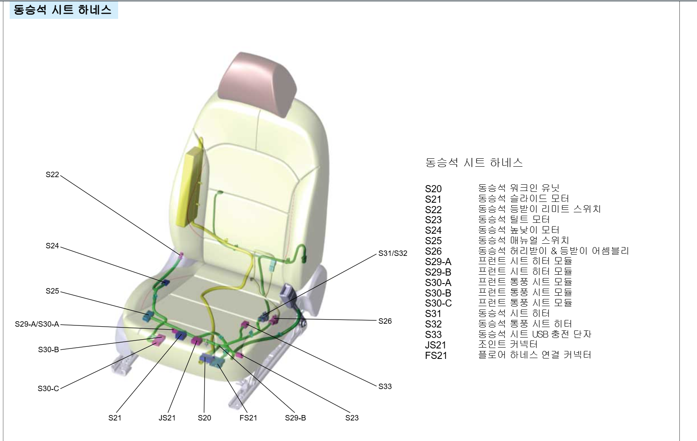
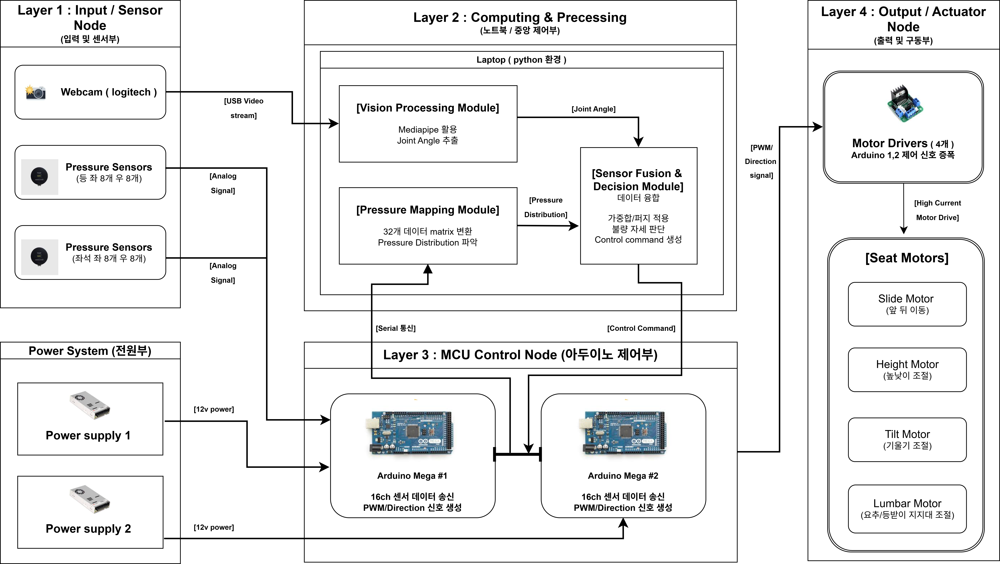

# 압력센서와 카메라를 이용한 자세 교정 의자

### Intelligent Posture Correction Chair

**2026 졸업작품전시회 | 캡스톤디자인**

- **참여학생:** 김건호, 박현
- **지도교수:** 박찬식
- **프로젝트 유형:** S/W + H/W

---

## 1. 프로젝트 소개

본 프로젝트는 압력센서와 카메라를 활용하여 사용자의 착석 자세를 실시간으로 분석하고, 의자의 모터를 자동으로 제어하여 올바른 자세를 유도하는 지능형 자세 교정 의자입니다.

장시간 좌식 생활로 발생할 수 있는 거북목, 굽은 등, 잘못된 착석 자세 등의 문제를 개선하기 위해 개발하였습니다.

좌판과 등받이에 배치된 총 32개의 압력센서와 MediaPipe 기반 카메라 영상 분석을 융합하여 자세를 판별하고, 자동차 시트의 4축 모터를 구동하여 사용자 맞춤형 자세 교정을 수행합니다.

## 2. 작품 사진

### 2.1 시트 하네스 구성도



시트 하네스 구성도.

### 2.2 전체 시스템 블록도



카메라와 압력센서에서 데이터를 수집하고, 노트북의 Python 프로그램에서 자세 판별 및 모터 제어 명령을 생성하는 시스템 구조입니다.

---

## 3. 시스템 구성

본 시스템은 노트북 1대, Arduino Mega 보드 2개, 압력센서 32개, 웹캠 및 4개의 시트 모터로 구성됩니다.

### 3.1 중앙 제어부 - Python

노트북에서 실행되는 통합 제어 프로그램입니다.

- OpenCV를 활용한 카메라 영상 처리
- MediaPipe Pose 기반 신체 랜드마크 검출
- 압력센서 데이터 수신 및 필터링
- 사용자별 자세 기준값 캘리브레이션
- 압력 데이터와 비전 데이터 융합
- 슬라이딩, 등 접촉 불량, 거북목 자세 판별
- 자세에 따른 모터 제어 명령 생성
- 실시간 디버깅 및 자세 상태 시각화

### 3.2 Arduino Mega A - 좌판 및 하부 모터

- 좌판 압력센서 16채널 데이터 수집
- 슬라이드 모터 제어
- 리프트(높낮이) 모터 제어
- Python 프로그램과 USB 시리얼 통신

### 3.3 Arduino Mega B - 등받이 및 상부 모터

- 등받이 압력센서 16채널 데이터 수집
- 틸트 모터 제어
- 럼버서포트 모터 제어
- Python 프로그램과 USB 시리얼 통신

### 3.4 통신 구조

두 Arduino 보드는 각각 16채널의 압력센서 데이터를 노트북으로 전송합니다.

- 통신 방식: USB Serial
- 통신 속도: 115200 bps
- A 보드: `A,센서값1,센서값2,...,센서값16`
- B 보드: `B,센서값1,센서값2,...,센서값16`

Python 프로그램은 수신한 데이터를 분석하고, 자세 판별 결과에 따라 각 모터의 구동 명령을 Arduino에 전송합니다.

---

## 4. 주요 구현 기능

### 4.1 압력센서 기반 자세 분석

- 좌판 및 등받이의 압력 분포 측정
- 센서별 영점 보정 및 노이즈 필터링
- 좌판 앞뒤 압력 비율 분석
- 등받이 어깨 부위의 접촉 압력 분석

### 4.2 카메라 기반 거북목 판별

- MediaPipe Pose를 활용한 신체 랜드마크 추출
- 귀와 어깨 랜드마크를 이용한 목 기울기 계산
- 목 각도와 압력 데이터를 융합한 거북목 판별
- 실시간 자세 상태 시각화

### 4.3 사용자 맞춤형 캘리브레이션

사용자가 바른 자세로 착석했을 때 압력 데이터를 수집하여 개인별 기준값을 설정합니다.

이를 통해 사용자마다 다른 체형 및 착석 특성을 고려한 자세 판별을 수행합니다.

### 4.4 4축 모터 자동 제어

| 모터 | 제어 기능 |
|---|---|
| Slide | 좌판 전후 위치 조절 |
| Lift | 의자 높이 조절 |
| Tilt | 등받이 각도 조절 |
| Lumbar | 요추 지지대 깊이 조절 |

자세 불량 유형에 따라 필요한 모터에 제어 명령을 전송합니다.

### 4.5 복합 자세 판별 및 순차 복귀

- 슬라이딩, 등 접촉 불량, 거북목 독립 판별
- 여러 자세 불량이 동시에 발생하는 상황 처리
- 동시 구동 모터 수 제한
- 모터 구동 시간 제한
- 정상 자세 회복 시 상체 및 하체 순차 복귀

---

## 5. 개발 환경

### Software

- Python
- OpenCV
- MediaPipe Pose
- PySerial
- Arduino IDE

### Hardware

- Arduino Mega 2560 × 2
- 압력센서 RA30P × 32
- 웹캠 × 1
- 자동차 시트 모터 × 4
- 모터 드라이버 × 4
- 파워서플라이 × 2
- 니로 EV 시트

---

## 6. 프로젝트 폴더 구조

```text
posture-correction-chair/
│
├── python/
│   ├── main.py
│   └── requirements.txt
│
├── arduino/
│   ├── board_a/
│   │   └── board_a.ino
│   └── board_b/
│       └── board_b.ino
│
├── images/
│   ├── chair_prototype.png
│   └── system_block_diagram.png
│
├── .gitignore
└── README.md
```

---

## 7. 실행 방법

### Step 1. Arduino 코드 업로드

Arduino IDE를 실행한 후, 다음 코드를 각 Arduino Mega 보드에 업로드합니다.

- A 보드: `arduino/board_a/board_a.ino`
- B 보드: `arduino/board_b/board_b.ino`

실제 연결된 Arduino 보드와 COM 포트를 확인해야 합니다.

### Step 2. 하드웨어 연결

- Arduino Mega 2개를 USB로 노트북에 연결
- 웹캠 연결
- 압력센서 및 모터 드라이버 연결 상태 확인
- 전원 및 모터 구동 상태 점검

### Step 3. Python 라이브러리 설치

VS Code 터미널에서 다음 명령을 실행합니다.

```bash
cd python
python -m pip install -r requirements.txt
```

### Step 4. 통합 프로그램 실행

```bash
python main.py
```

Python 프로그램 실행 전 Arduino IDE의 시리얼 모니터를 종료해야 합니다.

### Step 5. 사용자 캘리브레이션

1. 빈 의자 상태에서 압력센서 영점 보정을 수행합니다.
2. 사용자가 올바른 자세로 착석합니다.
3. 개인별 압력 기준값을 측정합니다.
4. 카메라 영상에서 신체 랜드마크 추적 상태를 확인합니다.
5. Enter 또는 S 키를 눌러 자세 판별 및 모터 제어를 시작합니다.

실행 중 Q 키를 누르면 프로그램을 종료할 수 있습니다.

**주의:** 카메라 인덱스와 시리얼 포트 환경은 사용자의 PC에 따라 달라질 수 있습니다. 실제 모터 구동 전에 전원, 배선, 구동 방향 및 정지 기능을 확인해야 합니다.

---

## 8. 개발 결과

- 32채널 압력센서와 카메라 기반 자세 데이터 융합 시스템 구현
- 사용자 맞춤형 캘리브레이션 기능 구현
- 슬라이딩, 등 접촉 불량, 거북목 자세 판별 알고리즘 구현
- 4축 시트 모터를 이용한 자동 자세 교정 기능 구현
- 우선순위 제어 및 순차 복귀 알고리즘 적용
- 자세 상태 및 모터 제어 정보를 표시하는 실시간 디버깅 화면 구현

본 프로젝트는 수동적인 착석 가구를 넘어, 사용자의 자세를 인식하고 능동적으로 자세 변화를 유도하는 지능형 의자를 구현하는 것을 목표로 하였습니다.

---

## 9. 코드 공개 및 검증 안내

원본 개발 코드는 Notion에 보관되어 있었으며, GitHub 공개를 위해 중복된 Python 및 Arduino 코드를 정리하였습니다.

최종 실행 프로그램은 다음 세 코드로 구성됩니다.

- `main.py`: Python 통합 제어 프로그램
- `board_a.ino`: 좌판 압력센서 및 슬라이드·리프트 제어
- `board_b.ino`: 등받이 압력센서 및 틸트·럼버서포트 제어

공개용 코드의 실제 보드 컴파일 및 하드웨어 동작은 별도 재검증이 필요합니다.

본 프로젝트는 교육 및 연구 목적의 시제품으로, 상용 제품 수준의 안전성이나 의료적 교정 효과가 검증된 시스템은 아닙니다.

---

## 10. 프로젝트 참여자

**김건호, 박현**

지도교수: **박찬식**

2026 졸업작품전시회 캡스톤디자인
